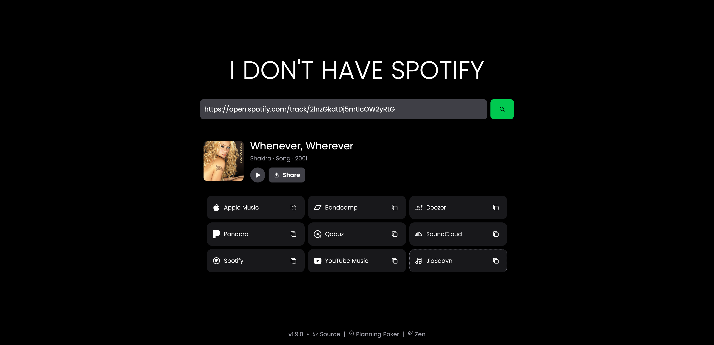

# I Don't Have Spotify

IDHS converts a streaming-service link into links to the same content on other platforms. It supports individual tracks, albums, artists, and podcasts, but not playlists. Results include cover art, audio previews when available, and a universal URL that other people can open without choosing a service first.

The project is a Bun and TypeScript server with a server-rendered web interface and a search API. You can run it as a standalone executable or Docker container; the public instance runs on Cloudflare Workers.

Public instance: https://idonthavespotify.sjdonado.com

<div align="center">
  
</div>

## Architecture

Link conversion separates source parsing from destination search:

```text
Source link → parser → metadata and search query → adapters → destination links
```

**Parsers** in `src/parsers/` identify the source platform and extract normalized metadata: title, artist, content type, cover art, and any audio preview. Each parser builds a query from that metadata, so adapters do not need to understand the original link format.

**Adapters** in `src/adapters/` search destination services and score candidate matches. A result contains a URL and two flags: `isVerified` indicates a strong match signal; `notAvailable` disables a result whose score is too low to trust. MusicBrainz can fill destinations that did not return a match. Service and content-type support vary, so a conversion does not guarantee a result on every platform.

The web interface uses nano-jsx for server-rendered HTML, htmx for result-fragment updates, and Stimulus for previews, sharing, and error handling. Universal links use `APP_URL?id=<id>`. Shared pages return source metadata first for link-preview crawlers, then load destination links into the card in a second request.

## Supported services

All services below except Invidious accept source links. Invidious is an additional destination derived from a YouTube result.

| Destination | Lookup method |
| --- | --- |
| Spotify | Web player GraphQL API |
| YouTube Music | YouTube search |
| Apple Music | Catalog search |
| Deezer | Official API |
| SoundCloud | Public search pages |
| Qobuz | Search API |
| Bandcamp | Search API |
| Pandora | Search API |
| JioSaavn | Search API |
| Apple Podcasts | Official API |
| Tidal | MusicBrainz fallback |
| Invidious | Derived from YouTube results |

### Service constraints

**Spotify** source metadata comes from embed pages. Destination search uses the web player's internal GraphQL API rather than the official Web API. An anonymous access token refreshes automatically through a TOTP flow that reads the player bundle's secret; no Spotify developer account is required.

**Tidal** has no direct search adapter: the required API entitlement is unavailable to this project, and its public pages have a bot wall. MusicBrainz supplies curated streaming relations instead. For songs, the fallback first looks up the ISRC from a verified Deezer match to identify the recording. Title-and-artist search is the backup, with relation lookups limited to about three seconds.

**Invidious** needs no upstream search. The adapter mirrors a YouTube watch, playlist, or channel path onto https://redirect.invidious.io, where the visitor selects a live instance. **Apple Music on Workers** resolves through catalog pages without an audio preview.

See `docs/architecture.md` for the conversion pipeline, fallback behavior, and runtime differences.

## Local development

Install **Bun 1.4.3 or newer**, then install the dependencies:

```sh
bun install
```

Configure a local `.env` using the endpoint settings in `.env.test` and the variable reference in `docs/self-hosting.md`. Supply your own credentials and never commit them. The YouTube adapter needs `YOUTUBE_API_KEY`, available from https://console.developers.google.com/. Set `APP_URL=http://localhost:3000` for local share links.

```sh
bun run dev
```

Open http://localhost:3000. The development command watches both server code and browser assets.

## Self-hosting

The supported self-hosting path is a single compiled executable, directly or inside Docker. It serves HTML, API responses, and embedded static assets without sidecars or a separate `public/` directory. Build the browser assets before compiling the server:

```sh
bun run build
bun run build:prod
NODE_ENV=production ./dist/idonthavespotify
```

The executable reads `.env` from its working directory. `PORT` changes the listening port, which defaults to 3000. Self-hosted instances keep browser and API search open; leave `PLUNK_API_KEY` unset to retain that behavior. Despite its name, this variable now selects public-instance restrictions and does not send email.

The app has no per-IP rate limiter. Protect publicly exposed instances with a rate-limiting reverse proxy or Cloudflare Bot Fight Mode and a Managed Challenge rule. Per-service budgets and circuit breakers limit upstream requests, but are not a substitute for edge protection.

`docs/self-hosting.md` covers environment settings, Docker builds, and deployment configuration. Before a Docker build, exclude environment-secret files from the build context; the current `.dockerignore` excludes only the local variants.

### API and Raycast

`API.md` documents the search endpoints and response formats. The Raycast extension connects to a self-hosted instance because the public site's programmatic search is disabled.

Install: https://www.raycast.com/sjdonado/idonthavespotify

<a title="Install idonthavespotify Raycast Extension" href="https://www.raycast.com/sjdonado/idonthavespotify"></a>

Extension source: https://github.com/raycast/extensions/tree/main/extensions/idonthavespotify

## Public instance and Workers deployment

The public site permits browser searches and shared links without login. `/api/search` returns 403 without calling upstream services; programmatic clients must use a self-hosted instance until API keys are available. The previous email-code wall is retired, and its auth endpoints return 410.

Cloudflare Bot Fight Mode filters known bots, while a host-scoped WAF Managed Challenge rule protects search routes. A challenge cannot be completed inside an htmx request, so the app navigates to `/verify`, returns to the original page, and resumes the search once.

Workers use platform fetch instead of the self-hosted TLS-impersonating HTTP transport, and their in-memory cache is per isolate. Pushes to `main` typecheck, lint, build the Worker bundle, audit native imports, and deploy with Wrangler. GitHub needs `CLOUDFLARE_API_TOKEN` and `CLOUDFLARE_ACCOUNT_ID`; Worker bindings must also provide the app's required environment settings. The exact WAF rule and operational constraints are maintained in `AGENTS.md`.

## Verification

```sh
bun run typecheck
bun run lint
bun run test
bun run test:e2e
```

`typecheck` uses Bun's native checker for the self-host, Worker, and e2e transport configurations. `typecheck:tsc` provides a TypeScript 7 compatibility cross-check. The package aliases keep TypeScript 7's compiler alongside Microsoft's TypeScript 6 API compatibility package, which ESLint still requires.

Existing tests exercise parsers, adapters, API routes, and other server behavior with local snapshots. The browser layer uses https://github.com/tester-army/e2e to declare conversion, universal-link reload, and error-handling journeys on desktop and phone-sized Chromium. It runs the real app with third-party HTTP fixtures, without AI credentials or live music-provider requests. The runner needs Node.js 24.8 or newer, or Node.js 22.22.3 or newer on the 22.x line; phone-sized Chromium does not establish iOS Safari coverage.

## Documentation

| Guide | Detailed coverage |
| --- | --- |
| `docs/architecture.md` | Conversion stages, service-specific behavior, shared-page loading, and runtime differences. |
| `docs/self-hosting.md` | Environment configuration, standalone and Docker setup, build-context safety, and Cloudflare operations. |
| `API.md` | Endpoints, request and response formats, and public-instance restrictions. |
| `docs/verification.md` | Journey coverage, test isolation, reports and traces, and the final verification sequence for agents. |

Contributions are welcome. Include the reason for the change and its verification results in your pull request.


Icon generated by https://deepai.org/machine-learning-model/text2img.
